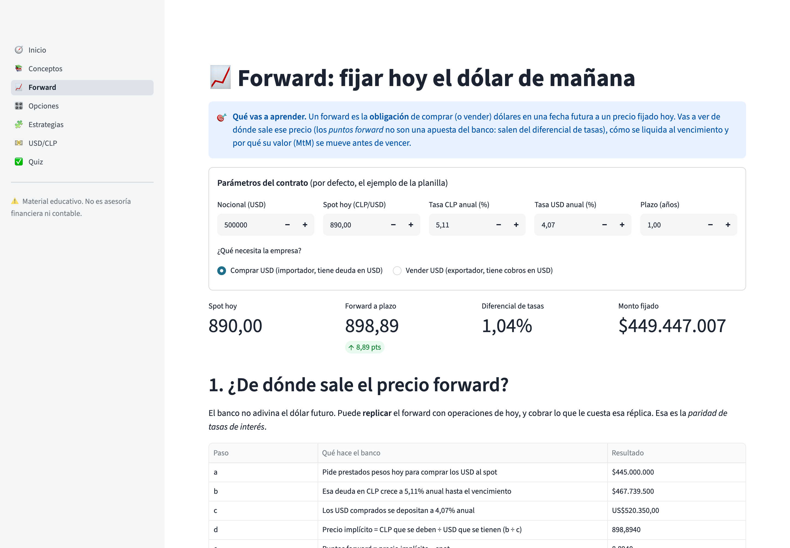
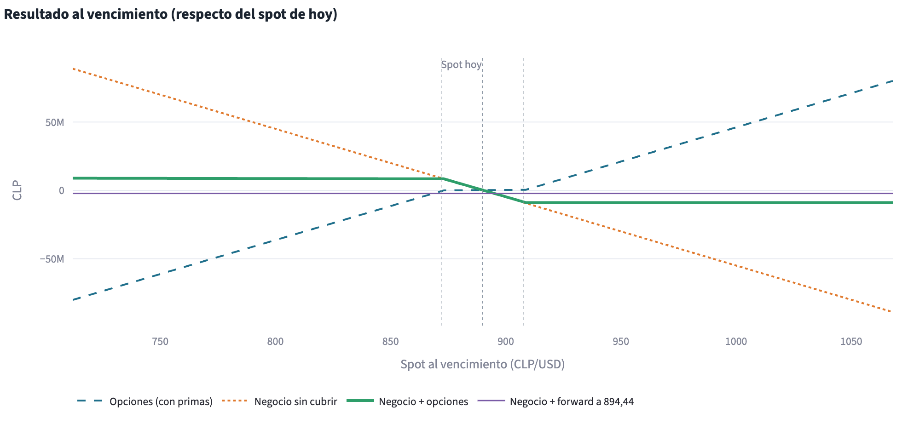

# Derivados 101 — forwards y opciones sobre el dólar, explicados con el dólar real

App educativa e interactiva para entender, sin fórmulas de memoria, cómo funcionan los
**derivados de moneda USD/CLP**: forwards, opciones y estrategias que combinan varias
opciones. Mueves un control, ves el gráfico cambiar y lees por qué.

Está pensada para equipos de finanzas no especialistas, estudiantes y cualquier persona
que alguna vez escuchó "tomamos un forward" en una reunión y se quedó con la duda.

> **Material educativo. No es asesoría financiera ni contable.**



<p align="center"></p>

<sub>Arriba: el forward replicado paso a paso con los números del ejemplo. Abajo: un collar de importador acota el resultado del negocio entre dos strikes, a costo cero.</sub>

---

## Cómo abrirla en tu computador (3 pasos)

No necesitas saber programar. Solo tener **Python 3.10 o superior** instalado.

### macOS / Linux

1. **Instala Python** desde [python.org/downloads](https://www.python.org/downloads/)
   (en Mac también sirve `brew install python`). Verifica en la Terminal: `python3 --version`.
2. **Descarga este proyecto**: botón verde *Code → Download ZIP* en GitHub y descomprímelo
   (o `git clone` si usas git).
3. **Abre la Terminal en la carpeta del proyecto y ejecuta:**

   ```bash
   bash scripts/run.sh
   ```

### Windows

1. **Instala Python** desde [python.org/downloads](https://www.python.org/downloads/).
   Durante la instalación marca la casilla **"Add python.exe to PATH"**.
2. **Descarga este proyecto**: *Code → Download ZIP* y descomprímelo.
3. **Abre la carpeta del proyecto y haz doble clic en `scripts\run.bat`**
   (o ejecútalo desde la consola: `scripts\run.bat`).

La primera vez el script crea un entorno aislado (`.venv`) e instala las dependencias;
tarda un par de minutos. Las siguientes veces abre directo. La app se abre sola en tu
navegador en `http://localhost:8501`. Para cerrarla, vuelve a la terminal y presiona
`Ctrl + C`.

<details>
<summary>Instalación manual (si prefieres hacerlo a mano)</summary>

```bash
python3 -m venv .venv
source .venv/bin/activate          # Windows: .venv\Scripts\activate
pip install -r requirements.txt
streamlit run app.py
```
</details>

---

## Qué aprendes en cada página

| Página | Qué vas a entender |
|---|---|
| **Inicio** | Qué es un derivado, la diferencia entre *cubrirse* y *especular*, y el mapa de la app. |
| **1 · Conceptos** | Preguntas frecuentes (qué es un forward, quién está al otro lado, qué pasa al vencimiento) y una introducción simplificada a cómo se contabilizan: a resultado vía valor de mercado (*mark-to-market*) vs. contabilidad de cobertura bajo IFRS 9. |
| **2 · Forward** | De dónde sale el precio forward (paridad de tasas: no es una "apuesta" del banco), armado paso a paso con un préstamo sintético; liquidación con entrega física vs. por compensación; costo cubierto vs. no cubierto según dónde termine el dólar; y cómo evoluciona su valor de mercado en el tiempo. |
| **3 · Opciones** | Call y put, compra y venta, perfil de ganancia/pérdida; valor intrínseco vs. valor tiempo; dentro/en/fuera del dinero (ITM/ATM/OTM); cómo se calcula la prima (modelo Garman-Kohlhagen); las "griegas"; y una simulación de 1.000 caminos posibles del dólar para ver por qué el tiempo tiene valor. |
| **4 · Estrategias** | Estrategias listas (collar para importador y para exportador, spreads, straddle, strangle, seagull…) o tu propia combinación de hasta 4 opciones; cómo se ven junto a tu exposición real en dólares; puntos de equilibrio, prima neta y comparación contra un forward. |
| **5 · USD/CLP** | El dólar observado histórico, su volatilidad, cuánto se ha movido en 1, 3, 6, 9 y 12 meses, y un ejercicio de "¿qué habría pasado si hubiera tomado un forward en tal fecha?". |
| **6 · Quiz** | Preguntas para comprobar lo aprendido, con explicación de cada respuesta. |

Los ejemplos usan casos genéricos (por ejemplo, *"un importador chileno que debe pagar
USD 500.000 en un año"*). Todos los valores son editables.

---

## Fuente de datos

- **Dólar observado** oficial publicado por el Banco Central de Chile, obtenido a través
  de la API pública [mindicador.cl](https://mindicador.cl).
- La app trae **un CSV incluido** (`data/usdclp_dolar_observado.csv`, desde enero 2024),
  así que funciona **sin internet**.
- **Modo en vivo (opcional):** desde la app puedes pedir los datos actualizados a
  mindicador.cl. Si la consulta falla, la app vuelve automáticamente al CSV incluido.
- Las tasas de interés y volatilidades de los ejemplos son **valores ilustrativos**,
  no cotizaciones de mercado. Para operar, consulta precios reales con tu contraparte.

---

## Cómo está organizado el código

Para quien quiera leerlo o reutilizarlo. Python 3.12, interfaz en [Streamlit](https://streamlit.io),
gráficos en Plotly. El cálculo está separado de la interfaz: toda la matemática vive en
funciones puras, testeadas, que no saben nada de pantallas.

```
derivados-101/
├── app.py                    # Entrada: navegación (st.navigation) con títulos e íconos
├── app_pages/                # Una página por tema (Inicio, Conceptos, Forward, ...)
├── src/derivados101/         # Núcleo de cálculo, sin interfaz
│   ├── forward.py            # Precio forward, sintético, liquidación, valor de mercado
│   ├── options.py            # Payoff, Garman-Kohlhagen, griegas, árbol binomial
│   ├── strategies.py         # Estrategias predefinidas, P&L combinado, breakevens
│   ├── market.py             # Datos USD/CLP, volatilidad, backtest, simulación
│   └── ui.py                 # Formatos ($ 1.234,56), paleta y disclaimer
├── tests/                    # Pruebas automáticas (pytest)
├── data/                     # CSV del dólar observado
├── scripts/                  # run.sh / run.bat para lanzar la app
├── pyproject.toml            # Metadatos y configuración de pytest y ruff
└── CONTRACT.md               # Especificación: firmas de funciones y convenciones
```

Convenciones: precios en **CLP por USD**, plazos en **años**, tasas como decimales
(`0.0511` = 5,11 %), capitalización compuesta anual. Ejemplo de referencia:
`890 × 1,0511 / 1,0407 = 898,89`.

Para desarrollar:

```bash
pip install -r requirements-dev.txt
pytest -q        # pyproject.toml ya agrega src/ al path
ruff check .     # reglas y versión (0.17.*) fijadas en pyproject.toml / requirements-dev.txt
```

---

## Aviso

**Material educativo. No es asesoría financiera ni contable.** Los modelos están
simplificados a propósito (por ejemplo, no incluyen costos de transacción, spreads
bancarios, riesgo de crédito ni el detalle completo de la norma contable). Antes de
contratar un derivado, consulta con tu banco, tu asesor y tu auditor.

## Licencia

[MIT](LICENSE) © 2026 Sergio Domínguez. Puedes usar, copiar y adaptar este material
citando la fuente.
