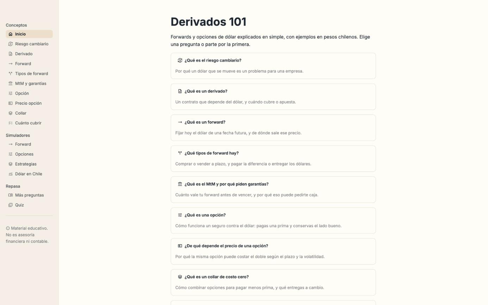
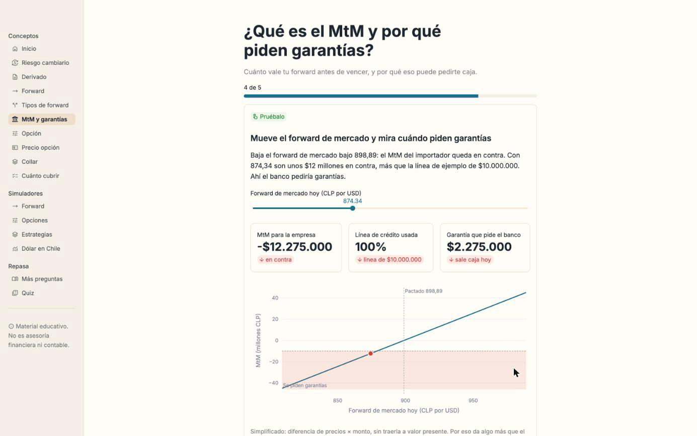
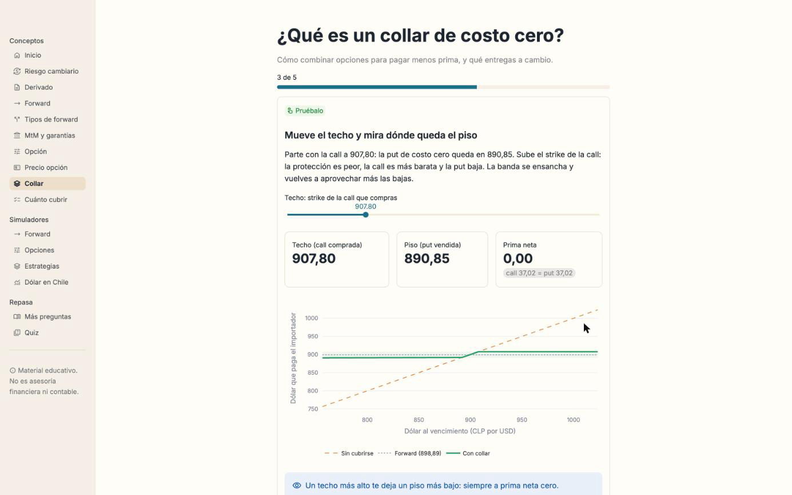

# Derivados 101

Forwards y opciones sobre el dólar, explicados en simple y con el dólar real.

### Úsala en línea: **[derivados-101.streamlit.app](https://derivados-101.streamlit.app)**

No necesitas instalar nada: se abre en el navegador, también en el celular.

> **Material educativo. No es asesoría financiera ni contable.**



---

## Qué es

Una app para entender cómo funcionan los **derivados de moneda USD/CLP**: forwards,
opciones y collares. Está pensada para personas con finanzas básicas que alguna vez
escucharon "tomamos un forward" en una reunión y se quedaron con la duda.

Cada concepto es una pregunta directa ("¿Qué es un forward?") con pocas pantallas:

1. la idea, en pocas líneas;
2. un ejemplo con números;
3. una calculadora para ver cómo funciona en la práctica;
4. tres ideas para llevarse.

No es un curso de valorización ni de contabilidad de coberturas. Donde simplifica, lo
dice: en la realidad hay márgenes del banco, curvas de tasas y contratos de crédito que
cambian los números.

<p align="center"> </p>

<sub>Izquierda: mueves el forward de mercado y ves el MtM, cuánta línea de crédito usa y cuándo sale caja como garantía. Derecha: subes el techo del collar y el piso de costo cero se ajusta solo.</sub>

## Qué hay en la app

**Conceptos.** Nueve preguntas, en orden de lectura:

1. ¿Qué es el riesgo cambiario?
2. ¿Qué es un derivado?
3. ¿Qué es un forward?
4. ¿Qué tipos de forward hay?
5. ¿Qué es el MtM y por qué piden garantías?
6. ¿Qué es una opción?
7. ¿De qué depende el precio de una opción?
8. ¿Qué es un collar de costo cero?
9. ¿Cuánto y cuándo cubrirse?

**Simuladores.** Para mover todos los parámetros: Forward (precio, liquidación, MtM),
Opciones (resultado al vencimiento y de qué está hecha la prima), Estrategias (presets y
combinaciones de hasta 4 opciones) y Dólar en Chile (histórico, cuánto se mueve y qué
habría pasado cubriéndose).

**Repasa.** Más preguntas frecuentes y un quiz corto.

Los ejemplos usan casos genéricos (*"un importador chileno que debe pagar US$500.000 en
un año"*) con cifras fijas rotuladas como ejemplo: spot 890, tasas de 5,11% en pesos y
4,07% en dólares, forward a 1 año de 898,89. En los simuladores, el dólar de partida es
el último observado, y también es solo un ejemplo.

## De dónde salen los datos

- **Dólar observado** del Banco Central de Chile, en `data/usdclp_dolar_observado.csv`
  (desde enero de 2024). Se actualiza solo cada día hábil desde la API oficial del Banco
  Central, con respaldo en [mindicador.cl](https://mindicador.cl). Las credenciales viven
  en los *Secrets* de GitHub: nunca en el código ni en la app publicada.
- **Tasas de referencia** en `data/tasas_referencia.csv`: tasas interbancarias a 3 meses de
  Chile y EE.UU. publicadas por la OCDE vía [FRED](https://fred.stlouisfed.org). Son una
  aproximación: un banco cotiza con sus propias tasas y su margen.
- **Volatilidades** de los ejemplos: valores ilustrativos, no cotizaciones de mercado.

La app no consulta internet al abrirse: lee esos CSV, así que carga rápido y no depende de
servicios externos. Para operar, consulta precios reales con tu banco.

## Cómo se publica

- **Producción:** [Streamlit Community Cloud](https://streamlit.io/cloud), desde la rama
  `main` de este repositorio (`app.py`, Python 3.12). Cada push a `main` la vuelve a publicar.
- **Datos:** el workflow [`actualizar-datos.yml`](.github/workflows/actualizar-datos.yml)
  corre de lunes a viernes cerca de las 9:00 de Chile y hace commit en `main` si hay datos nuevos.
- **Calidad:** el workflow [`ci.yml`](.github/workflows/ci.yml) corre los tests y `ruff` en
  Python 3.11 y 3.12 en cada push.

---

## Correrla en tu computador (opcional)

Solo necesitas **Python 3.11 o superior**.

- **macOS / Linux:** descarga el proyecto (*Code → Download ZIP*), abre la Terminal en la
  carpeta y ejecuta `bash scripts/run.sh`.
- **Windows:** descarga el proyecto, instala Python marcando **"Add python.exe to PATH"** y
  haz doble clic en `scripts\run.bat`.

La primera vez el script crea un entorno aislado (`.venv`) e instala las dependencias.
La app se abre en `http://localhost:8501`. Para cerrarla, `Ctrl + C` en la terminal.

<details>
<summary>Instalación manual</summary>

```bash
python3 -m venv .venv
source .venv/bin/activate          # Windows: .venv\Scripts\activate
pip install -r requirements.txt
streamlit run app.py
```
</details>

## Cómo está organizado el código

Interfaz en [Streamlit](https://streamlit.io), gráficos en Plotly. El cálculo está separado
de la interfaz: la matemática vive en funciones puras y testeadas.

```
derivados-101/
├── app.py                    # Entrada: menú (Conceptos, Simuladores, Repasa)
├── app_pages/                # Inicio, simuladores, más preguntas y quiz
├── src/derivados101/
│   ├── curso/                # Las 9 preguntas: textos y demos de cada pantalla (puro)
│   ├── curso_ui.py           # Dibuja las pantallas, las demos y sus gráficos
│   ├── forward.py            # Precio forward, liquidación, valor de mercado (MtM)
│   ├── options.py            # Payoff, prima (Garman-Kohlhagen), valor intrínseco y temporal
│   ├── strategies.py         # Estrategias predefinidas y collar de costo cero
│   ├── market.py             # Dólar observado, API del Banco Central, tasas, backtest
│   └── ui.py                 # Formatos ($1.234,56), paleta y disclaimer
├── scripts/                  # run.sh / run.bat y actualización de datos
├── data/                     # CSV del dólar observado y de tasas de referencia
├── tests/                    # Pruebas automáticas (pytest)
├── .github/workflows/        # CI y actualización diaria de datos
└── CONTRACT.md               # Especificación: firmas de funciones y convenciones
```

Convenciones: precios en **CLP por USD**, plazos en **años**, tasas como decimales
(`0.0511` = 5,11%), capitalización compuesta anual. Ejemplo de referencia:
`890 × 1,0511 / 1,0407 = 898,89`.

Para desarrollar:

```bash
pip install -r requirements-dev.txt
pytest -q
ruff check .
```

---

## Aviso

**Material educativo. No es asesoría financiera ni contable.** Los modelos están
simplificados a propósito: no incluyen costos de transacción, márgenes bancarios, riesgo
de crédito ni el detalle de la norma contable. Antes de contratar un derivado, consulta
con tu banco, tu asesor y tu auditor.

## Licencia

[MIT](LICENSE) © 2026 Sergio Domínguez. Puedes usar, copiar y adaptar este material
citando la fuente.
